  

  
  
  
  

2026 Information Technology graduate from **Pune Institute of Computer Technology** (CGPA **8.94/10**).
I build backend systems in Java and Python that are secure, tested and made to keep running, and I'm
building **FinTwin AI**, an AI money copilot for young Indian earners, now live in public beta.
Merged contributions to **Elasticsearch** and **Apache Lucene**, and two published research papers.

**Open to backend / software engineer roles.** I write about backend engineering, security and
applied AI on [LinkedIn](https://www.linkedin.com/in/syedmdsaad/).

---

## FinTwin AI

An AI money copilot for young Indian earners. It reads bank and UPI statements, categorizes every
transaction, and answers money questions from the user's own numbers. Designed, built and run end to end.

**[Live demo: one click, no sign-up](https://fintwin-web.azurewebsites.net)** &nbsp;·&nbsp; [Source on GitHub](https://github.com/SYEDMDSAAD/FinTwin.ai)

  

| | |
|---|---|
| **Architecture** | 4 services: a React 19 + Vite frontend, a Spring Boot 3.5 (Java 21) core API, a separate identity service, and a Python FastAPI AI service, over PostgreSQL with 26 Flyway migrations |
| **Data in** | Bank statements as CSV, PDF or Excel and DKIM-verified bank alert emails, with Account Aggregator linking in testing. The categorizer learns from user corrections, and transfers between a user's own accounts are excluded |
| **AI** | Self-hosted LLM copilot (qwen2.5 on Ollama, on a GPU) with a tool-calling loop. The tools have no user-ID parameter and every question carries a short-lived token signed by the core API, so the model can't read another user's data. Code does the maths, and an eval suite of real questions, graded by code, measures every prompt or model change |
| **Security** | JWT with refresh-token rotation and reuse detection, TOTP 2FA, Google OAuth, RBAC via a custom Spring Security permission evaluator, and AES-256-GCM field-level encryption with an HMAC blind index |
| **Reliability** | Resilience4j circuit breakers with statistical fallbacks when the AI is down, rate limiting per IP and per user, Caffeine caching, HikariCP tuning, N+1 fixes and paginated batch jobs. Real EMI and debt-to-income maths, and a water-fill allocator for goal savings |
| **Delivery** | Docker, Azure App Service, Grafana monitoring with 8 alert rules, 6 GitHub Actions workflows, and **1,100+ automated tests** (Testcontainers on real PostgreSQL, pytest, Vitest) |

---

## Open Source

Merged contributions to large distributed-systems and search codebases:

| Project | Contribution |
|---|---|
| [elastic/elasticsearch](https://github.com/elastic/elasticsearch/pull/142940) | Documented the `http_schema` field in AlibabaCloudSearchService configuration |
| [apache/lucene](https://github.com/apache/lucene/pull/15719) | Improved JavaDocs for the `org.apache.lucene.util` package |
| [TheAlgorithms/Java](https://github.com/TheAlgorithms/Java/pull/7275) | Added `RemoveStars` and `ComplexNumberMultiply` string algorithms |

Beyond those, I've opened 30+ pull requests against Elasticsearch and Lucene, chasing flaky
tests, resource leaks in the chunked fetch phase, ESQL planner bugs and memory exhaustion in
lookup joins. Reading a codebase that large is its own skill, and it's where most of what I know
about distributed systems actually came from.

---

## Selected Projects

| Project | What it does | Stack |
|---|---|---|
| [Forge](https://github.com/SYEDMDSAAD/forge) | An Alexa+ MCP server that learns new skills while you talk to it: it writes, sandbox-tests and installs its own tools | TypeScript, MCP (Streamable HTTP) |
| [Bluewren](https://github.com/SYEDMDSAAD/bluewren) | A self-hosted MCP server for Alexa+ that rebooks, refunds and helps travelers by voice when a flight goes wrong | TypeScript, MCP (Streamable HTTP) |
| [Real-Time Chat Platform](https://github.com/SYEDMDSAAD/Chat-S.io) | One-to-one and group messaging with delivery-status tracking; JWT + bcrypt sessions, <50 ms delivery across concurrent sessions | MERN, Socket.io |
| [Hybrid Cryptography over TLS](https://github.com/SYEDMDSAAD/Cryptography) | Client–server channel on TLS 1.2 with ECDHE-RSA and AES-256-GCM, X.509 auth via Java KeyStore | Java, JSSE/JCA |
| [Hospital Management System](https://github.com/SYEDMDSAAD/HMS) | Patient booking, provider messaging and an admin panel, with scheduling conflicts caught before they hit the database | MERN |
| [Emotion-Driven Music Recommender](https://github.com/SYEDMDSAAD/EmotionalDrivenMusicRecommender) | Reads facial expression in real time to infer mood, then curates a matching Spotify queue | Python, OpenCV |

More on the [portfolio →](https://syedmdsaad.github.io/Portfolio/)

---

## Research &amp; Publications

**Yoga Pose Detection and Correction Using Machine Learning Approaches** 
*ICCCNT 2025, IIT Indore — IEEE* 
Real-time posture correction model using CNN, XGBoost and MediaPipe, achieving **92% pose accuracy**.

**Machine Learning Techniques for Detecting DoS and DDoS Attacks: Methods, Attacks and Datasets** 
*Indian Journal of Technical Education (ISTE), 2026* 
Intrusion detection system using MLP and LSTM, achieving **>99% accuracy** on CIC-IDS benchmarks.

---

## Experience

**Machine Learning Intern (Google AI/ML Virtual Internship)** — EduSkills Foundation · *Jan 2025 – Apr 2025* 
Implemented ML pipelines for classification and NLP using CNN and XGBoost across 50,000+ records,
improving accuracy 15–20%. Designed RESTful APIs for secure inter-service transmission, improving
transfer efficiency by 30%.

**Machine Learning Intern | Team Lead** — Pune Institute of Computer Technology · *Feb 2025 – Apr 2025* 
Built a real-time posture analysis system with MediaPipe, CNN, XGBoost and SVM: 20% accuracy gain,
35% better error detection, 25% faster processing. Led a 3-member team across design, deployment,
testing, performance tuning and UX. Published at IEEE ICCCNT 2025.

---

## Tech Stack

**Languages**

**Backend &amp; APIs**

**AI**

**Data &amp; Storage**

**Cloud, DevOps &amp; Testing**

**Frontend**

---

  <i>Open to backend / software engineer roles · Pune, India</i>

